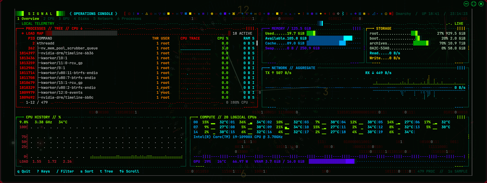

# PeaceMachine Signal

A read-only Linux terminal system monitor with neon graphs, animated glyphs, and a sortable process tree.



## Requirements

- Linux with Python 3.10 or newer, the Python curses module, and a Unicode terminal.
- psutil 6.0 or newer. Install it from the requirements file below.
- NVIDIA GPU readings use `nvidia-smi` when available. Per-core temperatures use Intel's `coretemp` sensors when available.

## Run

From the repository directory, create a virtual environment.

```bash
python3 -m venv .venv
```

Install the dependency.

```bash
.venv/bin/python -m pip install -r requirements.txt
```

Start the dashboard.

```bash
.venv/bin/python signal-monitor
```

Use a terminal at least 112 columns by 28 rows for the wide layout. The compact layout fits 62 by 20.

| Key | Action |
| --- | --- |
| 1–6 | Switch between Overview, CPU, GPU, Disks, Network, and Processes |
| / | Filter processes by name or PID |
| s / r | Change the process sort field or reverse the order |
| t | Toggle the process tree |
| b | Toggle the animated binary |
| ? / q | Show shortcuts or quit |

Thank you for supporting my work!
